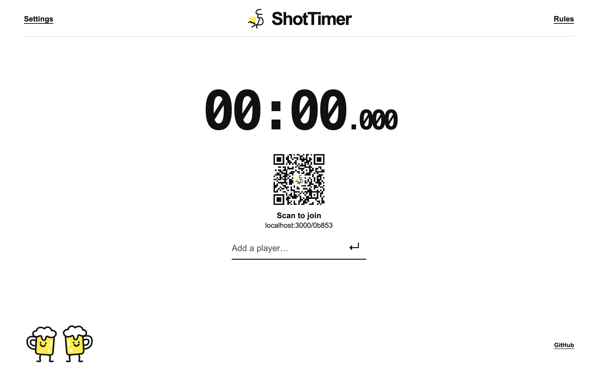
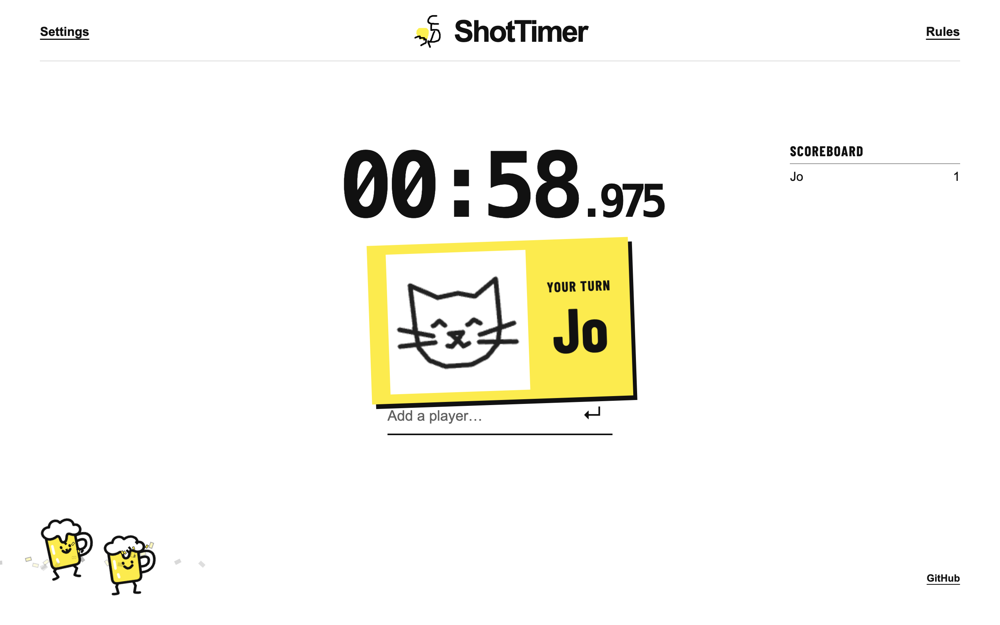
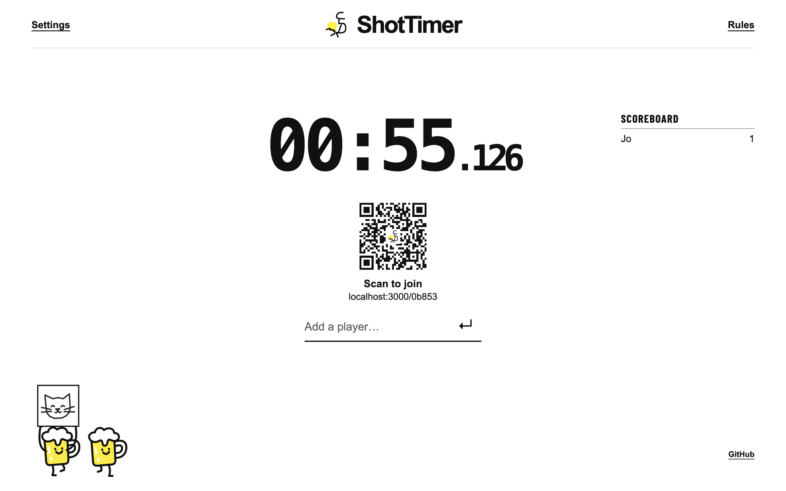

# ShotTimer



Simple, dumb drinking game, based on randomly selecting a player to drink at a random interval, with annoying blinking, sounds, and dumb text-to-speech.

Previously horribly written in plain JS (+ a drizzle of jQuery), now (still horribly written as I don't know it yet) solid-js!

Invite your friends, have them type in their name and see who comes out alive.


| When a player is picked | Between draws |
| --- | --- |
|  |  |

## Get started

### Requirements

- node 22.x
- pnpm 9.15.4

### Setup

```
$ pnpm install && cp .sample.env .env && pnpm build
```


### Development

```
$ pnpm install && pnpm dev
```

And open `http://localhost:3000`.

### Tests

```
$ pnpm test
```


### Deployment

The client-code transpiles to a client-side-rendered SolidJS app, so you'll need hosting for that as the hono-server is just for SSE connections and external joins.
